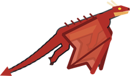
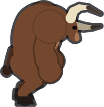
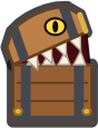

# Dungeons & Desktops

An idle **desktop pet** / dungeon-defense experiment in Python and PySide6. Creatures live on your real windows — no sprites, procedural animation and AI-driven agents.

Product notes and deep design live in [docs/PRD.md](docs/PRD.md). Marketing pages are in [`site/`](site/).

<p align="center">
  
  &nbsp;&nbsp;
  
  &nbsp;&nbsp;
  
  &nbsp;&nbsp;
  
</p>

## Download

Prebuilt apps: [dev release](https://github.com/Werd6/Dugeons_and_Desktops/releases/tag/dev)

- **macOS:** `Dungeons-and-Desktops-macOS.zip` — unzip and open (signed + notarized in CI).
- **Windows:** `Dungeons-and-Desktops-Windows-Setup.exe` — run the installer. If SmartScreen warns, More info → Run anyway.

CI refreshes that `dev` release on every push to `main`. Tags `v*` publish immutable releases.

## Develop

Python 3.12+:

```bash
python3 -m venv .venv
.venv/bin/pip install -e '.[dev]'
.venv/bin/python -m dungeons_desktops --desktop   # live desktop pet
.venv/bin/python -m dungeons_desktops             # rig preview
.venv/bin/pytest -q
```

macOS pulls in Quartz via optional deps; Windows uses Win32 window bounds through ctypes.

Package locally:

```bash
.venv/bin/pip install -e '.[packaging]'
.venv/bin/pyinstaller packaging/dungeons_desktops.spec
```

macOS signing/notarization helpers: [`packaging/macos/`](packaging/macos/). Windows installer script: [`packaging/windows/installer.iss`](packaging/windows/installer.iss).

## Play notes

- Starters: **Dragon, Goblins, Mimic** (Dragon first). Claim more from **Unlocks** in the Command Board.
- Open the app a second time (or use the tray) to show the menu. **Quit game** is on the Play tab.
- Progress is local to your machine (`QSettings`).
