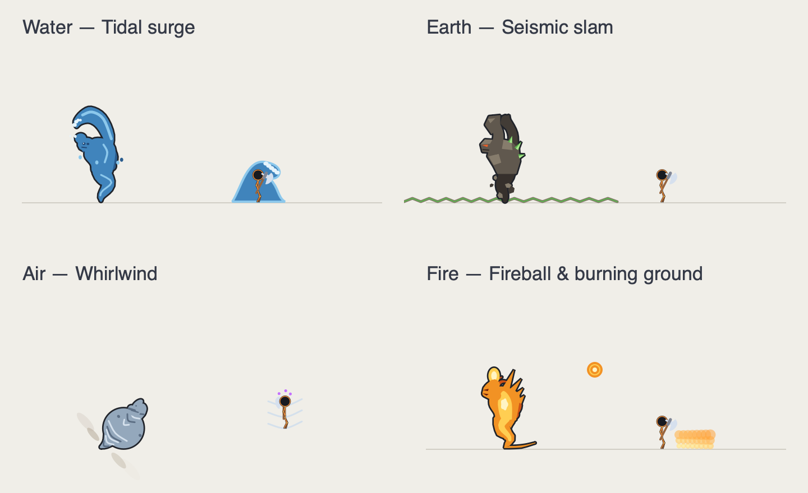

# Elemental abilities previews

The four panels show water's tidal surge, earth's seismic slam, air's whirlwind,
and fire's fireball and burning ground. These are staged renderer stills with
windup poses and active effects shown together for review, rather than screenshots
of one simulation instant.



Individual previews: [water](water.png), [earth](earth.png), [air](air.png),
[fire](fire.png).

The remaining rendering work from the Cursor elemental-abilities plan is complete:
shared punches, fire's raised casting arm, shift compression, clipped burrow
sinking/emergence, directional tornado poses, waves, shockwaves, caught-victim
wind bands, fireballs, and burning patches. Burrow holes, exit cracks, and rocks
use the existing shared debris renderer. Effects draw independently of the owner's
visibility, form, and death fade. Waves and whirlwinds now carry knocked-down
victims before releasing them.

Preview controls: **E** spawns one elemental; **J** advances its form.

Validation commands (run from the project root):

```sh
.venv/bin/ruff check .
QT_QPA_PLATFORM=offscreen .venv/bin/pytest -q -k 'not test_chain_lightning_arcs_to_three_more_near_each_other'
```

The excluded lich test is the existing failure called out in the original plan.
Running the initial full suite reproduced it: the fifth target takes 2 damage
instead of 0. No lich code or tests were changed or permanently skipped.
