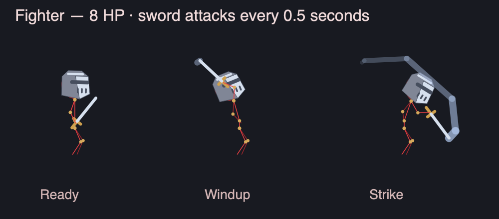

# Fighter

A red adventurer with a steel knight's helmet and a sword. Fighters have **8 HP**,
normal walking speed, 30 px melee reach, and deal the standard 1 damage per hit.
They attack every **0.5 seconds**, twice as often as the paladin's 1 second cycle.

Fighters join normal adventurer spawning. Select **0** in the rig preview and
press **F** to attack; **1–9** keep their existing class assignments.

The fighter uses the existing class registry, sword drawing and animation, melee
targeting, hit handling, and sword trails. Its sword timeline is compressed so
animation recovery does not prevent the faster attack cadence. The helmet follows
the existing head pose and costume rendering, including ragdolls.
