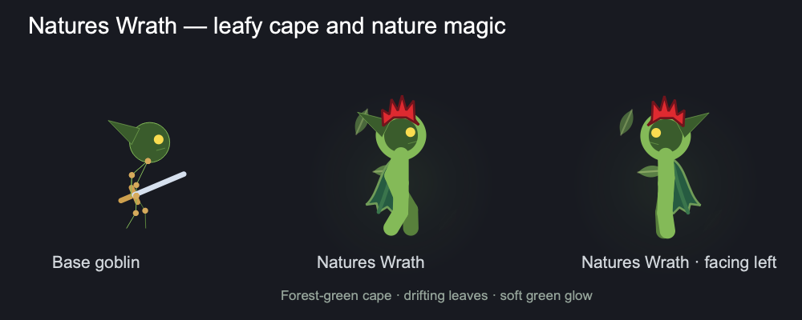
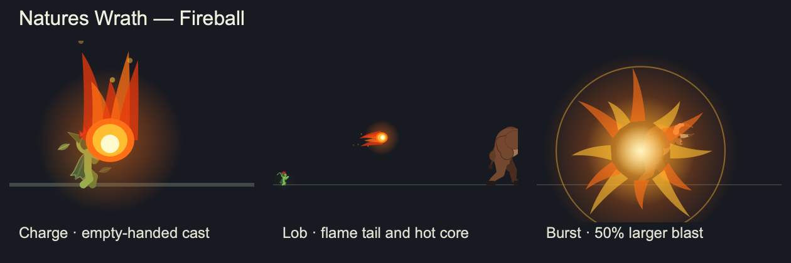
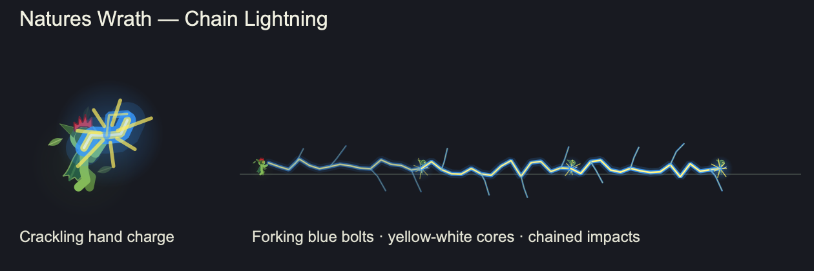
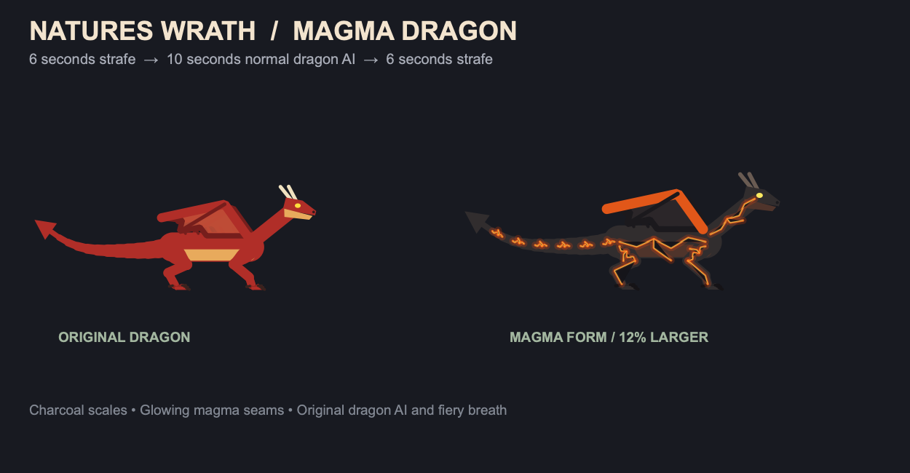
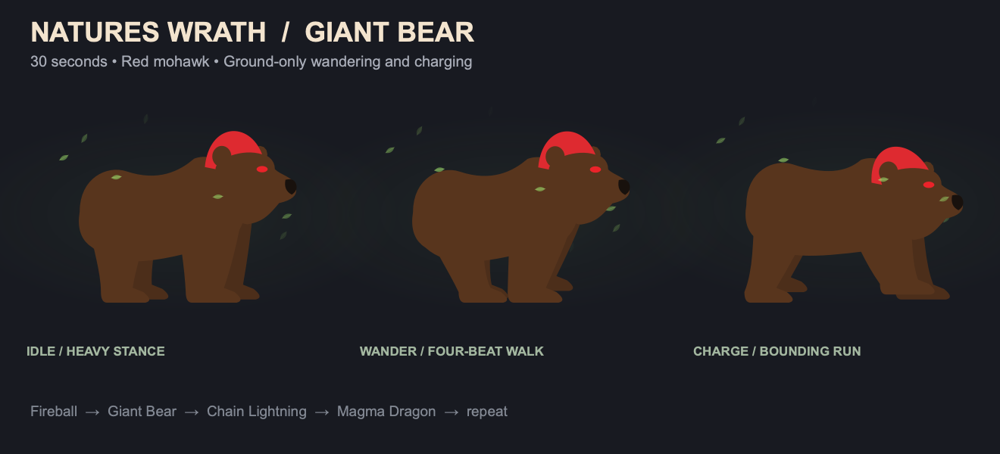
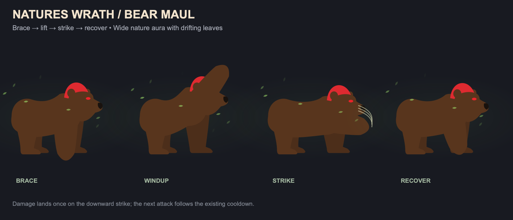

# Natures Wrath

The hero druid uses the existing goblin skeleton and face at 105% size, with a red
mohawk and empty hands. Walking, climbing, and hanging use regular druid speeds;
navigation clearances follow his smaller body. His body has thicker, smooth lines
without joint markers. Three small leaves drift upward through a faint green glow
while he is alive; this ambient effect is cosmetic and pauses with the simulation.
A short forest-green cape has a leaf-cut hem and sways behind his shoulders, with
more lift while moving. It follows his pose when climbing or ragdolling.

Spawn him with **Spawn Natures Wrath** in the desktop settings or tray menu, or
**Add Natures Wrath** in the rig preview. Programmatic spawning uses
`world.add_stickman(point, "hero_druid", wander=True)`.

He belongs to both `world.heroes` and `world.stickmen`, so monsters can target him
and the existing damage, healing, conditions, ragdoll, despawn, and named health
bar systems handle him. He is excluded from random adventurer spawning.

Health is **60 HP**, matching The Soulforger. His ability rotation currently
runs **Fireball → Giant Bear → Chain Lightning → Magma Dragon → repeat**. He
casts automatically at defenders within 420 px and stays in range while wandering;
the preview's Attack control uses the same rotation and cooldown.

Fireball uses the lich's lobbed trajectory, 4 damage, 0.9-second casting gesture
(release at 0.45 seconds), and 1.4-second pause after each cast. The projectile
and explosion are 50% larger: the burst reaches 105 px. Orange flames, a bright
yellow-white core, and trailing embers distinguish it from the lich's magic.
It bursts on defender contact, reaching its aim point, or hitting the floor;
like the lich's spell it passes through windows. It damages defenders only,
without hurting the caster or friendly adventurers, and does not raise skeletons.

Chain Lightning crackles around his casting hand, then releases jagged bolts with
electric-blue edges, yellow-white centers, branching sparks, and bright impacts.
It starts at his selected defender and jumps to the nearest unhit defender within
300 px of each hit, up to 10 additional targets, matching the lich's current chain
targeting. Damage is 3 on each of the first two targets, then 2 per further target.
Hops arrive 0.08 seconds apart; each defender is hit once, and allies are spared.
The casting gesture takes 0.9 seconds, followed by a 1.2-second recovery.

Magma Dragon releases after the same 0.45-second windup and uses the original
red dragon's rig and AI at **112% size**, recolored charcoal with glowing orange
magma seams, dark wings and amber eyes. It starts strafing immediately for
**6 seconds**, spends **10 seconds** in normal dragon AI (landing, prowling and
clawing), then strafes another **6 seconds** before returning to goblin form.
The original fire breath and claw behavior target defenders, with 5 damage and a
one-second per-target damage interval. There is a 1.4-second recovery afterward.

Giant Bear lasts **30 seconds**, with a simple dark-brown silhouette. The body-part
reference guides the compact torso, larger head (about half the torso length),
broad upper legs and substantial paws. Rear legs swing as smooth, knee-free masses;
the thicker front legs have only a slight bend. His eyes are plain red ovals. The **red mohawk**
is a smooth arcing fan that follows his crown and sweeps back when charging.
There are no decorative outlines, fur marks, claws or separate muzzle/shoulder patches. It ambles at 32 px/s with a four-beat walk, then
lowers its head and switches to a bounding 165 px/s charge toward enemies on the
same continuous walkable surface. Its maul plants its feet, lifts a front paw,
swipes downward with a short claw trail, then recovers. The animation lasts
0.68 seconds and deals 6 damage once at the 0.34-second strike, with the existing
1.1-second attack interval. An enemy that moves out of the swipe can dodge it;
stun freezes the animation, and death or losing support cancels the attack.
These combat values are tuning defaults.

Bear form retains the hero's nature magic: eight small leaves drift in front of
and behind the body through a faint green glow, spread across a much larger area.
The effect follows the bear and uses the simulation clock, so rendering cannot
advance particles or alter gameplay.
It cannot climb, jump gaps, or chase onto other platforms: it stops at ledges,
rides moving windows, and falls onto a walkable surface if its support disappears.
After 30 seconds it returns to goblin form and continues with Chain Lightning after 1.4 seconds.

Both forms keep the same hero identity, health, damage, and friendly allegiance.
Their actual bodies are targetable; neither is added to the defender roster.
Stun pauses movement while the form timer continues. Death or control effects
end the form; normal expiry returns him at his current position, falling safely
if still airborne. Transformations never heal or respawn him.

Casting leaves his hands empty and keeps one hand gripping while climbing or
hanging. Stun, blindness, mind control, or falling interrupt the windup; a spell
already released finishes its flight. Manual movement resumes after casting.

The feature lives in `src/dungeons_desktops/game/heroes/natures_wrath/`:
`actor.py` owns behavior, `model.py` owns the rig and navigation dimensions, and
`render.py` owns the mohawk, body styling, and ambient nature magic. Shared goblin
facial features live in `game/defenders/goblins/appearance.py`; shared hero stats live in
`game/adventurers/model.py` under `HEROES["hero_druid"]`.
`spells.py` defines rotation slots, tuning, projectiles, and area damage;
`casting.py` poses his hands, and `spell_render.py` draws spell effects.
`dragon.py` adapts the existing dragon AI and implements the 6/10/6 phases;
`dragon_render.py` adds its magma palette and seams. `bear.py` owns the ground-only
bear simulation and gaits; `bear_render.py` draws its body, paws and mohawk.

