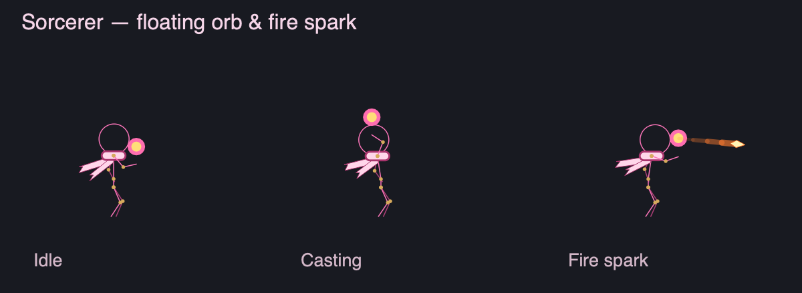

# Sorcerer

A pink adventurer with a pale scarf and a magic orb floating above its casting
hand. It joins normal adventurer spawning; select it with **9** in the rig preview
and press **F** to cast.

The sorcerer shares the wizard's 280 px range, 2.2 second cooldown, 4 HP, and
one-damage spell hit. Its attack is a single orange fire spark with a bright core,
a trail, and sparks on arrival.

Implementation uses the existing class registry, wand casting/aiming timeline,
weapon strokes, costume rendering, ranged seeking, and missile simulation.
The fire variant retains existing targeting, hit attribution, and hostile
thrall behavior.
