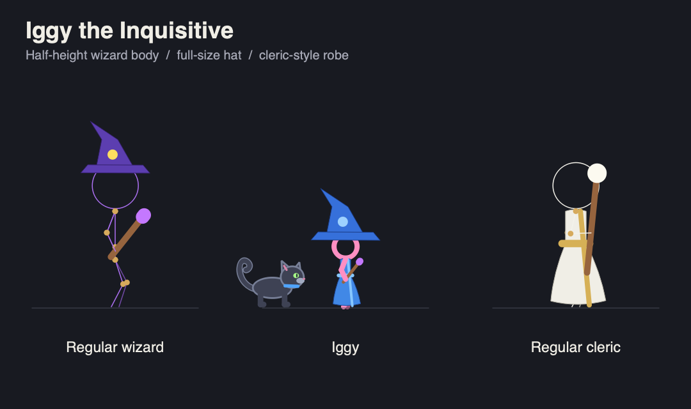
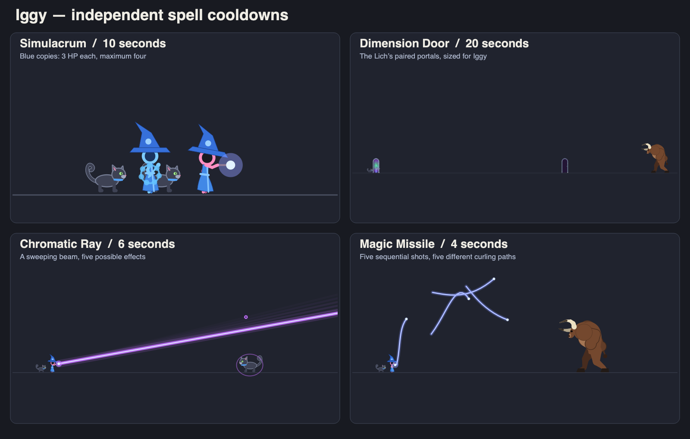
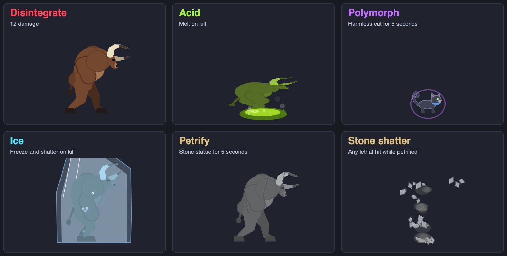

# Iggy the Inquisitive

The gnome wizard hero uses the ordinary wizard's body at **half height**, including
his head, limbs, and wand. His stick figure is **pink with slightly thicker lines**.
His blue wizard hat keeps its **full original size**, with the brim seated on his
smaller head. He wears a **blue cleric-style robe**, with light blue sash, stole,
and hat decoration, fitted to his smaller body and animated with his legs.

Use **Spawn Iggy** in desktop settings or the tray menu, or **Add Iggy** in the
preview. He is also available as `hero_wizard` through `SimWorld.add_stickman`
and `DesktopSession.spawn_at_edge`.

His foundation includes hero health bars, targeting, healing, ragdolls, cleanup,
and navigation sized for his smaller rig. He has 60 HP and walks, climbs, and hangs
at the ordinary wizard's travel speeds. Iggy and his copies are immune to the
Mind Flayer's blast and pulse stuns.

A small charcoal cat with bright eyes and a blue collar follows him over the same
surface routes. Its paws trot while moving and its curled tail swishes at rest.
It is a passive familiar, outside combat targeting, and accompanies Dimension Door.

Each spell has its **own cooldown**, starting when released. Iggy chooses among
ready spells instead of following a fixed rotation. Simulacrum takes priority
whenever ready and a copy slot is free, even with no enemy nearby. Otherwise,
Dimension Door takes priority when he needs to reposition. He finishes his current
cast and recovery before starting another; all spell clocks keep counting down.

| Spell | Cooldown | Behavior |
|---|---|---|
| Simulacrum | 10 seconds | Summons a blue copy with 3 HP; at most four living copies per Iggy. |
| Dimension Door | 20 seconds | Uses the Lich's paired portals, fade timing, and safe casting-distance repositioning. First ready after 4 seconds. |
| Chromatic Ray | 6 seconds | A randomly colored beam sweeps across its target for 1.6 seconds, reaching 600 pixels and passing through multiple enemies. |
| Magic Missile | 4 seconds | Five separate homing missiles, launched 0.18 seconds apart along independently randomized, curling paths. |

Chromatic Ray randomly chooses one of five results per cast. Every enemy touched
receives that result once, and the beam continues through enemies it hits.

| Ray | Color | Result |
|---|---|---|
| Disintegrate | Red | 12 damage. |
| Acid | Lime green | 4 damage; lethal hits melt the enemy into a bubbling puddle. |
| Polymorph | Violet | A harmless cat appearance for 5 seconds, with attacks paused. No damage. |
| Ice | Cyan | 4 damage; lethal hits freeze the enemy, then shatter it into ice shards. |
| Petrify | Gold | A stone statue for 5 seconds, with movement and attacks paused. No damage. Any lethal attack during petrification shatters the statue into rubble. |

Transformations expire independently of the caster and can be refreshed by another
ray. Transformed enemies retain their HP and remain targetable. Acid and Ice reuse
the dragon death timing and particles. Its sweep follows the Chimera's breath:
0.4 radians to either side of its aim, tracking its target and continuing across
the last known position if the target falls. The beam stops at the desktop floor
or ceiling and leaves a brief colored trail as Iggy turns his wand.
Each Magic Missile deals 1 damage, for 5 total if all five reach a live target.

Beam collisions snapshot enemy geometry once per sweep update, reject bodies
outside the beam, and intersect skeletal limbs and creature body segments directly.
Statue and elemental tints use Qt image composition, cached for the transformation.

Copies use the same rig, blue clothing, blue body and wand, and their own cooldowns
for Dimension Door, Chromatic Ray, and Magic Missile. They cannot cast Simulacrum.
They participate in enemy targeting, damage, healing, navigation, and cleanup,
without adding hero health bars. Losing a copy frees a summon slot; copies remain
until defeated, even if the original Iggy falls.

Interrupted windups do not spend a cooldown. Interrupting an ongoing volley stops
unreleased shots, while missiles already flying finish. Interrupting a channeled
ray stops its damage immediately and fades its light. Door destinations track
moved windows and are revalidated before teleporting. Iggy cannot be targeted or
damaged during the fully phased part of the door animation.

Implementation and tuning live in `game/heroes/the_inquisitive`.

