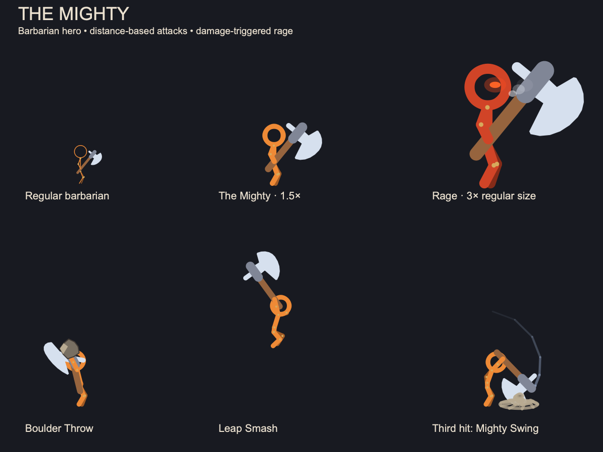

# The Mighty

The barbarian hero uses the standard orange barbarian's proportions at **1.5×
size**, with thicker body and head lines. His war axe has a longer, thicker haft
and a much broader crescent blade. It keeps the regular barbarian's overhead chop.

Use **Spawn The Mighty** in desktop settings or the tray menu, or **Add The Mighty**
in the preview. The hero is also available as `hero_barbarian` through
`SimWorld.add_stickman` and `DesktopSession.spawn_at_edge`.

He participates in hero health bars, enemy targeting, healing, navigation,
ragdolls, and cleanup. Walking, climbing, and hanging use the enlarged rig and
its own terrain planner. Travel speed stays at the regular barbarian's pace.

He has **60 HP** and chooses attacks by distance to an enemy's nearest body part:

| Distance | Attack | Damage |
|---|---|---|
| Up to 50 px | Axe melee | 2 |
| Every third melee attack | Mighty Swing: overhead ground smash, 65 px radius | 12 |
| 50–220 px | Leap Smash: windup, airborne arc, impact on landing, 70 px radius | 8 |
| 220–520 px | Boulder Throw: overhand lob, 28 px impact radius | 6 |

Leap Smash can launch from the ground, a climbing grip, or a hanging grip. It
checks nearby solid landing spots and alternate arcs: climbing launches rise clear
of a window lip, hanging launches drop toward their target, and low ceilings use
a lower arc. He throws instead when there is no safe leap, including airborne
enemies without a nearby landing. The third-melee ground smash requires footing;
normal melee and throws remain available while climbing. Attacks damage enemies,
not allies. Interrupted windups do not release attacks; a stunned leap lands
without its damaging smash. Released boulders finish flying after their caster dies.
Boulder Throw has its own **6-second cooldown**, starting when the rock is released.
While it recovers, he paths toward his enemy and uses Leap Smash as soon as he is
in range with a clear landing. Melee and Leap Smash remain available during the
throw cooldown; an interrupted throw does not spend it.

**Rage** triggers on damage actually received, lasts **10 seconds**, and refreshes
on each subsequent damaging hit. He becomes **2× his normal hero size** (3× a
regular barbarian), turns red with glowing eyes and snorts steam like the Minotaur.
His rig, axe, hit area, melee reach, and impact radii grow with him. Rage adds **2
damage** to every attack: melee 4, Mighty Swing 14, Leap Smash 10, Boulder Throw 8.
Projectile damage is fixed when released. Health does not reset when changing size.

The implementation and tuning live in `game/heroes/the_mighty`.

